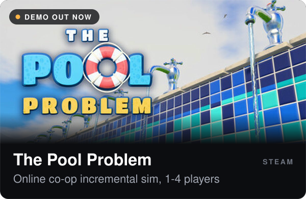
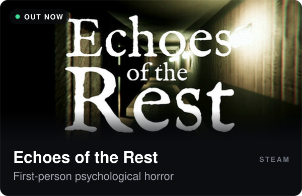
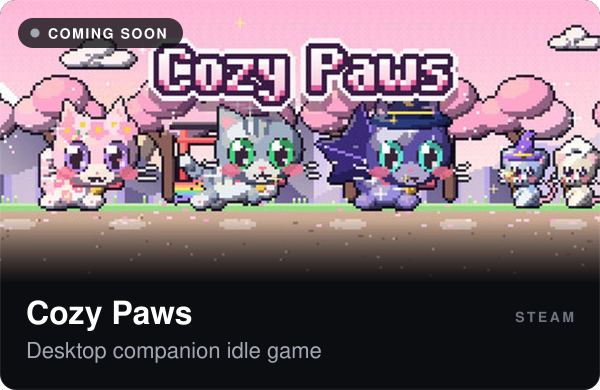
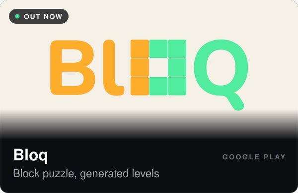
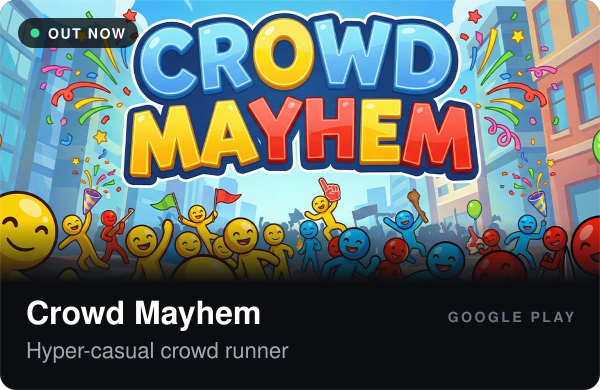
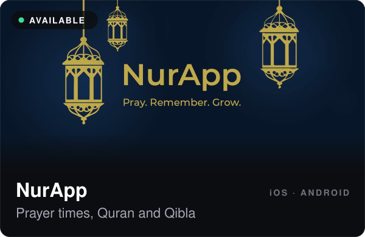
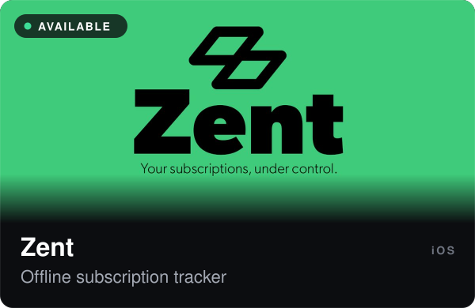

  <a href="https://feronlinegames.com/"><b>feronlinegames.com</b></a>
  &nbsp;&nbsp;/&nbsp;&nbsp;
  <a href="https://www.linkedin.com/in/ferhattopcuoglu/"><b>LinkedIn</b></a>

I make games on my own under FerOnline Games, from the first prototype to the store page. Right now I'm building **The Pool Problem**, a four-player online co-op game on Netcode for GameObjects and Steamworks.

 

<h3>On Steam</h3>

  
  
  

<h3>On Google Play</h3>

  
  

<h3>Apps</h3>

  
  

NurApp is also on <a href="https://play.google.com/store/apps/details?id=com.zirzapp.nurapp">Google Play</a>.

 
 

<h3>Toolkit</h3>

**Unity** · C# · Netcode for GameObjects · Steamworks · Cinemachine · HDRP 
**React Native** · Expo · TypeScript · Next.js 
**Python** · PyTorch · OpenCV
