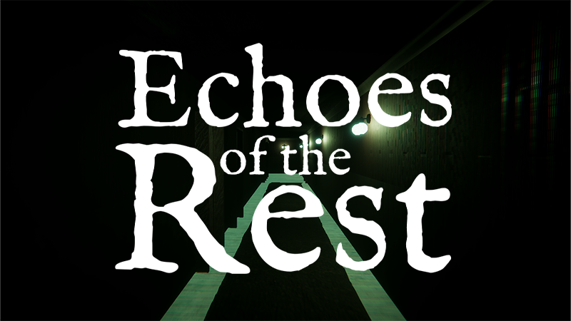

<p align="center">
  
</p>

<p align="center">
  <a href="https://feronlinegames.com/"></a>
  <a href="https://www.linkedin.com/in/ferhattopcuoglu/"></a>
  <a href="mailto:ferhattopcuoglu256@gmail.com"></a>
</p>

### `> PLAYER 1`

I make games on my own under **FerOnline Games** in Istanbul, from the first prototype to the store page. So far that's a horror game on Steam, an online co-op game with a public demo, and casual mobile games on Google Play. When I'm not making games, I build mobile apps with React Native.

### `> NOW LOADING`

```text
The Pool Problem   [##########-----]   demo is out on Steam, full game in progress
Cozy Paws          [########-------]   coming soon on Steam
Keyception         [####-----------]   in development
```

### `> SELECT YOUR GAME`

<table>
  <tr>
    <td align="center" width="33%">
      <a href="https://store.steampowered.com/app/5550040/The_Pool_Problem/"></a><br />
      <b>The Pool Problem</b><br />
      <sub>Fill a pool with up to 3 friends, from one spoon to a waterfall. Online co-op incremental sim.</sub><br />
      <a href="https://store.steampowered.com/app/5550040/The_Pool_Problem/"></a>
    </td>
    <td align="center" width="33%">
      <a href="https://store.steampowered.com/app/4160870/Echoes_of_the_Rest/"></a><br />
      <b>Echoes of the Rest</b><br />
      <sub>First-person psychological horror. Explore Joe's house, find the clues, reach one of several endings.</sub><br />
      <a href="https://store.steampowered.com/app/4160870/Echoes_of_the_Rest/"></a>
    </td>
    <td align="center" width="33%">
      <a href="https://store.steampowered.com/app/5498660/Cozy_Paws/"></a><br />
      <b>Cozy Paws</b><br />
      <sub>Cats fight mice on your taskbar while you work. Desktop idle game with Steam item drops.</sub><br />
      <a href="https://store.steampowered.com/app/5498660/Cozy_Paws/"></a>
    </td>
  </tr>
</table>

### `> ON THE GO`

<table>
  <tr>
    <td align="center" width="50%">
      <a href="https://play.google.com/store/apps/details?id=com.feronlinegames.bloq"></a><br />
      <b>Bloq</b><br />
      <sub>Fill the grid, clear the level. Every level is generated and always solvable.</sub><br />
      <a href="https://play.google.com/store/apps/details?id=com.feronlinegames.bloq"></a>
    </td>
    <td align="center" width="50%">
      <a href="https://play.google.com/store/apps/details?id=com.feronlinegames.crowdmayhem"></a><br />
      <b>Crowd Mayhem</b><br />
      <sub>Grow your crowd through the gates, then take on the boss. Hyper-casual runner.</sub><br />
      <a href="https://play.google.com/store/apps/details?id=com.feronlinegames.crowdmayhem"></a>
    </td>
  </tr>
  <tr>
    <td align="center" width="50%">
      <a href="https://apps.apple.com/us/app/nurapp-prayer-times/id6761554058"></a><br />
      <b>NurApp</b><br />
      <sub>Prayer times, Quran and Qibla finder.</sub><br />
      <a href="https://play.google.com/store/apps/details?id=com.zirzapp.nurapp"></a>
      <a href="https://apps.apple.com/us/app/nurapp-prayer-times/id6761554058"></a>
    </td>
    <td align="center" width="50%">
      <a href="https://apps.apple.com/us/app/zent-subscription-tracker/id6779643211"></a><br />
      <b>Zent</b><br />
      <sub>Keeps track of your subscriptions. Offline, no account needed.</sub><br />
      <a href="https://apps.apple.com/us/app/zent-subscription-tracker/id6779643211"></a>
    </td>
  </tr>
</table>

### `> INVENTORY`

<p align="center">
  
</p>

<p align="center"><sub>Netcode for GameObjects · Steamworks · Cinemachine · HDRP · Expo</sub></p>

<p align="center">
  
</p>
