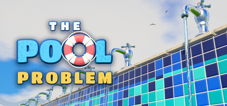
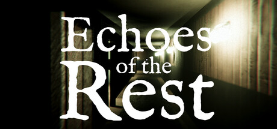
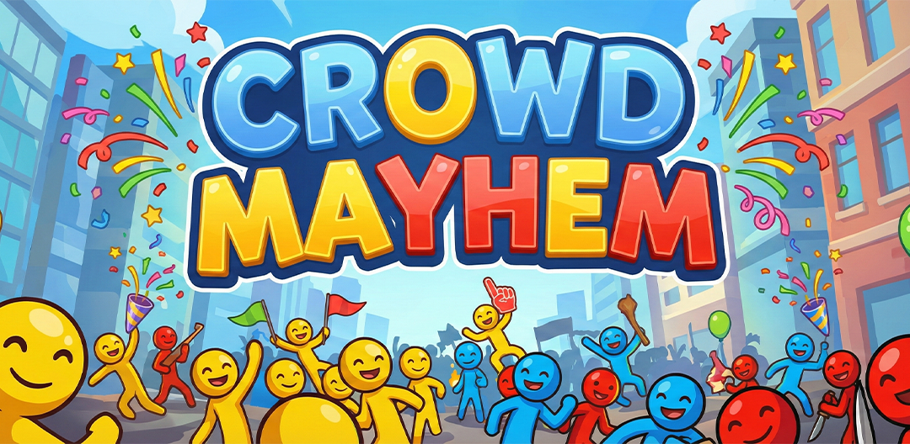
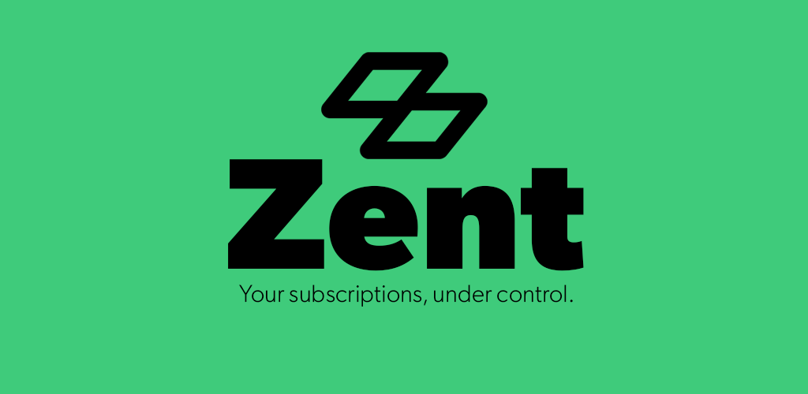

<picture>
  <source media="(prefers-color-scheme: dark)" srcset="assets/header-dark.svg" />
  <source media="(prefers-color-scheme: light)" srcset="assets/header-light.svg" />
  
</picture>

  <a href="https://feronlinegames.com/">feronlinegames.com</a>
  &nbsp;&nbsp;·&nbsp;&nbsp;
  <a href="https://www.linkedin.com/in/ferhattopcuoglu/">LinkedIn</a>
  &nbsp;&nbsp;·&nbsp;&nbsp;
  <a href="mailto:ferhattopcuoglu256@gmail.com">ferhattopcuoglu256@gmail.com</a>

 

I make games independently under **FerOnline Games**, taking each one from first prototype to store release. My work so far spans a narrative horror game on Steam, an online co-op game with a public demo, and casual games on Google Play. Alongside games, I build mobile apps with React Native.

Currently developing **The Pool Problem**, a four-player online co-op game built on Netcode for GameObjects and Steamworks, and **Cozy Paws**, a desktop companion game for Steam.

 

#### PC

<table>
  <tr>
    <td valign="top" width="33%">
      
       <b>The Pool Problem</b>
       Online co-op incremental sim for up to four players.
       <a href="https://store.steampowered.com/app/5550040/The_Pool_Problem/">Demo on Steam →</a>
    </td>
    <td valign="top" width="33%">
      
       <b>Echoes of the Rest</b>
       First-person psychological horror with multiple endings.
       <a href="https://store.steampowered.com/app/4160870/Echoes_of_the_Rest/">Available on Steam →</a>
    </td>
    <td valign="top" width="33%">
      
       <b>Cozy Paws</b>
       Desktop companion idle game with Steam item drops.
       <a href="https://store.steampowered.com/app/5498660/Cozy_Paws/">Wishlist on Steam →</a>
    </td>
  </tr>
</table>

#### Mobile

<table>
  <tr>
    <td valign="top" width="25%">
      
       <b>Bloq</b>
       Puzzle game with generated, always-solvable levels.
       <a href="https://play.google.com/store/apps/details?id=com.feronlinegames.bloq">Google Play →</a>
    </td>
    <td valign="top" width="25%">
      
       <b>Crowd Mayhem</b>
       Hyper-casual crowd runner.
       <a href="https://play.google.com/store/apps/details?id=com.feronlinegames.crowdmayhem">Google Play →</a>
    </td>
    <td valign="top" width="25%">
      
       <b>NurApp</b>
       Prayer times, Quran and Qibla.
       <a href="https://play.google.com/store/apps/details?id=com.zirzapp.nurapp">Google Play</a> · <a href="https://apps.apple.com/us/app/nurapp-prayer-times/id6761554058">App Store →</a>
    </td>
    <td valign="top" width="25%">
      
       <b>Zent</b>
       Offline subscription tracker.
       <a href="https://apps.apple.com/us/app/zent-subscription-tracker/id6779643211">App Store →</a>
    </td>
  </tr>
</table>

#### Toolkit

Unity · C# · Netcode for GameObjects · Steamworks · Cinemachine · HDRP&nbsp;&nbsp;&nbsp;|&nbsp;&nbsp;&nbsp;React Native · Expo · TypeScript · Next.js&nbsp;&nbsp;&nbsp;|&nbsp;&nbsp;&nbsp;Python · PyTorch · OpenCV

 
 

FerOnline Games &nbsp;·&nbsp; Istanbul

