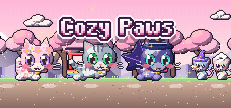
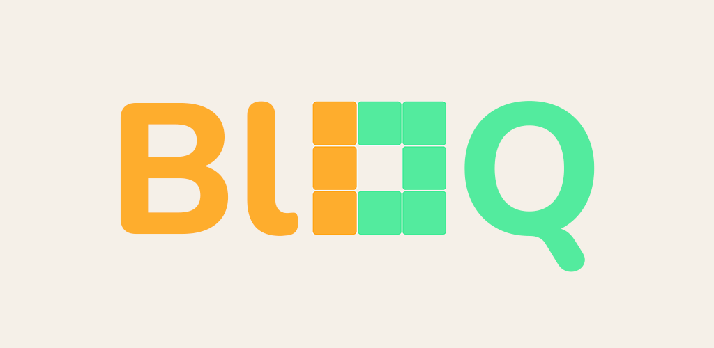

## Ferhat Topcuoğlu

Unity game developer based in Istanbul. I make games on my own under **FerOnline Games** and handle everything from the first prototype to the store page. So far that means a horror game on Steam, an online co-op game with a public demo, and casual mobile games on Google Play. I also build mobile apps with React Native.

Right now I'm working on **The Pool Problem**, a 4-player online co-op incremental sim built with Netcode for GameObjects and Steamworks, and **Cozy Paws**, a desktop companion idle game that sits on your taskbar.

[feronlinegames.com](https://feronlinegames.com/) · [LinkedIn](https://www.linkedin.com/in/ferhattopcuoglu/) · [ferhattopcuoglu256@gmail.com](mailto:ferhattopcuoglu256@gmail.com)

### Games on Steam

<table>
  <tr>
    <td align="center" width="33%">
       
      <b>The Pool Problem</b> 
      Online co-op incremental sim for up to 4 players 
      <a href="https://store.steampowered.com/app/5550040/The_Pool_Problem/">Steam</a> · demo out now
    </td>
    <td align="center" width="33%">
       
      <b>Echoes of the Rest</b> 
      First-person psychological horror, Unity HDRP 
      <a href="https://store.steampowered.com/app/4160870/Echoes_of_the_Rest/">Steam</a> · released Jan 2026
    </td>
    <td align="center" width="33%">
       
      <b>Cozy Paws</b> 
      Desktop companion idle game with Steam item drops 
      <a href="https://store.steampowered.com/app/5498660/Cozy_Paws/">Steam</a> · coming soon
    </td>
  </tr>
</table>

### On mobile

<table>
  <tr>
    <td align="center" width="50%">
       
      <b>Bloq</b> (game) 
      Block puzzle with procedurally generated, always-solvable levels 
      <a href="https://play.google.com/store/apps/details?id=com.feronlinegames.bloq">Google Play</a>
    </td>
    <td align="center" width="50%">
       
      <b>Crowd Mayhem</b> (game) 
      Hyper-casual crowd runner 
      <a href="https://play.google.com/store/apps/details?id=com.feronlinegames.crowdmayhem">Google Play</a>
    </td>
  </tr>
  <tr>
    <td align="center" width="50%">
       
      <b>NurApp</b> (app) 
      Prayer times, Quran and Qibla finder 
      <a href="https://play.google.com/store/apps/details?id=com.zirzapp.nurapp">Google Play</a> · <a href="https://apps.apple.com/us/app/nurapp-prayer-times/id6761554058">App Store</a>
    </td>
    <td align="center" width="50%">
       
      <b>Zent</b> (app) 
      Offline subscription tracker, no account needed 
      <a href="https://apps.apple.com/us/app/zent-subscription-tracker/id6779643211">App Store</a>
    </td>
  </tr>
</table>

### What I work with

**Games:** Unity, C#, Netcode for GameObjects, Steamworks, Cinemachine, HDRP 
**Apps:** React Native, Expo, TypeScript, Next.js 
**Also:** Python, PyTorch and OpenCV from my computer vision internships at Ford Otosan
